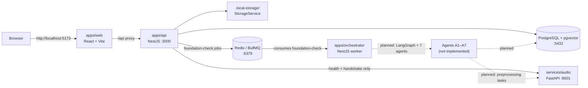

# Voice Intelligence Platform

A multilingual (English / Hindi / Hinglish) voice intelligence platform. The intended product takes a
consented recording, assesses its audio quality, transcribes it with speaker diarization, researches
and validates the claims made in it, and produces a report in which every assertion carries its
provenance.

> **Current status: Phase 1 (platform foundation) is complete.** You can upload a recording, store it
> and see it in the web app with an honest "not started" processing status. **No transcription,
> diarization, AI agents, research, fact validation or reporting is implemented yet.** Later phases
> need explicit approval (see [Limitations and roadmap](#13-current-limitations-and-roadmap)).

## Table of contents

1. [Project overview](#1-project-overview)
2. [Architecture](#2-architecture)
3. [Prerequisites](#3-prerequisites)
4. [Initial setup](#4-initial-setup)
5. [Running the application locally](#5-running-the-application-locally)
6. [Accessing the application](#6-accessing-the-application)
7. [Docker and infrastructure commands](#7-docker-and-infrastructure-commands)
8. [Database commands](#8-database-commands)
9. [Testing and quality checks](#9-testing-and-quality-checks)
10. [Screenshots and current UI](#10-screenshots-and-current-ui)
11. [Troubleshooting](#11-troubleshooting)
12. [Stopping the application](#12-stopping-the-application)
13. [Current limitations and roadmap](#13-current-limitations-and-roadmap)
14. [Useful documentation](#14-useful-documentation)

All commands below are run from the **repository root** unless a step says otherwise.

---

## 1. Project overview

### Purpose

The platform is designed to turn long, multilingual recordings into evidence-backed reports. The
approved design has seven product agents (ADR-0001, ADR-0019): Audio Quality, Transcription (with
language identification, diarization and uncertainty), Context Intelligence, Research, Fact
Validation, Reporting and an independent QA agent, orchestrated with LangGraph.

### Technology stack

| Layer         | Technology                                                                                    |
| ------------- | --------------------------------------------------------------------------------------------- |
| Monorepo      | pnpm 12 workspaces, Turborepo, TypeScript 6.0, ESLint, Prettier (ADR-0005)                    |
| Frontend      | React, TypeScript, Vite, Tailwind CSS, shadcn/ui on Radix (ADR-0022), lucide-react (ADR-0024) |
| API           | NestJS (`apps/api`), zod contracts, Drizzle ORM                                               |
| Worker        | NestJS standalone app (`apps/orchestrator`), BullMQ                                           |
| Audio service | Python 3.12, FastAPI + uvicorn (provisional, ADR-0023), managed with uv                       |
| Data          | PostgreSQL 18 with pgvector 0.8.7, Redis 8.8 (BullMQ only)                                    |
| Storage       | Local filesystem (`.local-storage/`), behind an S3-ready `StorageService` interface           |
| Local infra   | Docker Compose (`infra/docker/compose.yaml`)                                                  |
| Tests         | Vitest, Jest, Pytest, Playwright                                                              |

### What exists today

**Implemented functionality**

- Chunked, resumable recording upload with a required consent attestation, progress and cancel.
- Server-side validation: size cap, MIME allow-list, file-signature check, SHA-256 hashing.
- A recording library with cursor pagination and a recording detail page.
- A run record created at upload with status `created`, shown as "Not started" (ADR-0025).
- Workspace isolation: other workspaces' resources return 404 (a single development workspace).
- Content-free audit events and JSON logs.
- Light and dark themes, a responsive layout, and loading, empty and error states.

**Foundation available (no product behaviour yet)**

- Health and readiness endpoints for the API and the audio service.
- A Node ↔ Python contract handshake (`POST /v1/handshake`) with shared fixtures.
- A BullMQ `foundation-check` queue: the API produces a job, the orchestrator consumes it and returns
  an acknowledgement. It does not process audio.
- The database schema for workspaces, recordings, upload sessions, consent, runs and audit events.

**Planned, not implemented**

- All seven agents and the LangGraph pipeline; audio preprocessing (decode, normalise, VAD,
  segmentation); speech-to-text; diarization; research; fact validation; reporting; QA.
- Authentication and authorisation, S3 storage, playback, deletion, real-time progress.

---

## 2. Architecture

| Component             | Location             | Responsibility today                                                                                                                                             |
| --------------------- | -------------------- | ---------------------------------------------------------------------------------------------------------------------------------------------------------------- |
| Frontend              | `apps/web`           | React app served by Vite on port 5173. Calls the API through Vite's `/api` proxy, so the browser stays same-origin.                                              |
| API                   | `apps/api`           | NestJS HTTP API under `/api/v1`: validation, workspace scoping, persistence, local storage, audit events, health. Produces `foundation-check` jobs.              |
| Orchestrator          | `apps/orchestrator`  | NestJS standalone worker that owns the BullMQ consumers (ADR-0002). **Today it only consumes `foundation-check`. LangGraph and the agents are not implemented.** |
| Audio service         | `services/audio`     | Internal Python service: `/health/live`, `/health/ready`, `POST /v1/handshake`. **No audio processing yet.** No database or Redis access (enforced by tests).    |
| Contracts             | `packages/contracts` | zod schemas shared by web, API and orchestrator, mirrored in Python for the audio-service API.                                                                   |
| Database package      | `packages/db`        | Drizzle schema, migrations, migrate and seed CLIs.                                                                                                               |
| PostgreSQL + pgvector | Docker               | Application data. pgvector is enabled, but no embedding tables exist (ADR-0011).                                                                                 |
| Redis + BullMQ        | Docker               | Job queues only (`noeviction`, append-only file).                                                                                                                |
| Local object storage  | `.local-storage/`    | Uploaded audio, keyed by UUIDs. Git-ignored.                                                                                                                     |
| Docker Compose        | `infra/docker`       | Runs PostgreSQL and Redis locally (and optionally the audio service).                                                                                            |



Solid lines exist today; dashed lines are planned. Details: [Phase 1 foundation](docs/development/PHASE1_FOUNDATION.md),
[LLD](docs/architecture/LLD.md), [agent architecture](docs/architecture/AGENT_ARCHITECTURE.md).

---

## 3. Prerequisites

Developed and verified on macOS on Apple Silicon (arm64). The Docker images used
(`pgvector/pgvector:0.8.7-pg18-trixie`, `redis:8.8.4-alpine`) run natively on arm64.

| Tool           | Required version                                           | Check                                                |
| -------------- | ---------------------------------------------------------- | ---------------------------------------------------- |
| Node.js        | 26.x (`.nvmrc`; `engines.node` is `>=26`)                  | `node --version`                                     |
| pnpm           | 12.x (`packageManager` is `pnpm@12.21.0`). Do not use npm. | `pnpm --version`                                     |
| uv             | 0.13.x                                                     | `uv --version`                                       |
| Python         | 3.12 (`services/audio/.python-version`); uv provides it    | `uv run --directory services/audio python --version` |
| Docker Desktop | current, running                                           | `docker info`                                        |
| Docker Compose | v2 or later (`docker compose`, not `docker-compose`)       | `docker compose version`                             |

- **FFmpeg is not required** for Phase 1 on the host. Phase 1 code never invokes it; only the optional
  audio-service Docker image installs it for later phases.
- If you use nvm, run `nvm use` in the repository root to pick up `.nvmrc`.

---

## 4. Initial setup

Run these once on a new machine, from the repository root, in order.

**1. Clone and enter the repository**

```sh
git clone <repository-url> voice-intelligence-platform
```

```sh
cd voice-intelligence-platform
```

**2. Create `.env` from the example**

```sh
cp .env.example .env
```

Open `.env` in your editor and replace every `change-me` value. The database password appears in
three places (`POSTGRES_PASSWORD`, `DATABASE_URL`, `TEST_DATABASE_URL`); they must match. One way to
generate and apply a random password without displaying it:

```sh
sed -i '' "s/change-me/$(openssl rand -hex 24)/g" .env
```

(`sed -i ''` is the macOS form.) `.env` is git-ignored. Never commit it or paste its values anywhere.

**3. Install JavaScript dependencies**

```sh
pnpm install
```

**4. Create the Python environment for the audio service**

```sh
pnpm audio:sync
```

**5. Install the Playwright browser (only needed for end-to-end tests)**

```sh
cd apps/web && pnpm exec playwright install chromium && cd ../..
```

**6. Start PostgreSQL and Redis** (Docker Desktop must be running)

```sh
pnpm infra:up
```

**7. Build the workspace packages and apps**

```sh
pnpm build
```

**8. Apply database migrations**

```sh
pnpm db:migrate
```

**9. Seed the development workspace**

```sh
pnpm db:seed
```

The PostgreSQL init script also creates the integration-test database `<POSTGRES_DB>_test`
(`vip_test` with the example values) the first time the data volume is created.

### Once vs. every time

| When                      | Commands                                                                                   |
| ------------------------- | ------------------------------------------------------------------------------------------ |
| Once per machine          | Steps 1–5, 8 and 9                                                                         |
| After pulling new changes | `pnpm install`, `pnpm audio:sync`, `pnpm build`, `pnpm db:migrate` (re-running is a no-op) |
| Every working session     | `pnpm infra:up`, then the components in [section 5](#5-running-the-application-locally)    |

---

## 5. Running the application locally

There is **no single command that starts everything.** `pnpm dev` runs the `dev` script of every
JavaScript package through Turborepo (API, orchestrator, web, and the contracts/db watchers), but it
does **not** start the Python audio service or Docker. The recommended way is one terminal per
component.

**Start order:** infrastructure → audio service → API → orchestrator → frontend. The API needs
PostgreSQL and Redis; it starts without the audio service but reports it as down in `/health`. The
frontend needs the API.

### Terminal 1: PostgreSQL and Redis

```sh
pnpm infra:up
```

- Expected: `Container vip-postgres-1 Healthy` and `Container vip-redis-1 Healthy`. The command waits
  for the health checks and returns.
- Ports: PostgreSQL `127.0.0.1:5432`, Redis `127.0.0.1:6379`.
- Verify:

```sh
docker compose -f infra/docker/compose.yaml --env-file .env ps
```

This terminal is free again once the command returns; the containers keep running in the background.

### Terminal 2: Python audio service

```sh
pnpm audio:dev
```

- Expected log line: `Uvicorn running on http://127.0.0.1:8001`.
- URL: <http://127.0.0.1:8001> (interactive docs at `/docs` outside production).
- Verify:

```sh
curl http://127.0.0.1:8001/health/live
```

Expected: `{"status":"ok","service":"audio-service","version":"0.1.0"}`.

Note: `pnpm audio:dev` does **not** read `.env`. The service uses its defaults (host `127.0.0.1`,
port `8001`) unless `AUDIO_SERVICE_*` variables are exported in the shell.

### Terminal 3: NestJS API

```sh
pnpm --filter @vip/api dev
```

- Expected log line: a JSON entry with `"msg":"api_started","port":3000`.
- URL: <http://127.0.0.1:3000/api/v1>.
- Verify:

```sh
curl http://127.0.0.1:3000/api/v1/health
```

Expected: `"status":"ok"` with `postgres`, `redis` and `audio-service` listed as `up`.

### Terminal 4: Orchestrator (BullMQ worker)

```sh
pnpm --filter @vip/orchestrator dev
```

- Expected log line: `"msg":"worker_started","queue":"foundation-check","concurrency":2`.
- It has no HTTP port. It is only needed for the queue check below; uploads do not enqueue jobs in
  Phase 1.
- Verify (in another terminal, after the API has been built):

```sh
pnpm --filter @vip/api run foundation-check
```

Expected: `{"ok":true,...,"processedBy":"orchestrator",...}`.

### Terminal 5: Frontend

```sh
pnpm --filter @vip/web dev
```

- Expected: `VITE v… ready` and `Local: http://localhost:5173/`.
- Open <http://localhost:5173> in a browser.
- Verify the proxy to the API:

```sh
curl http://localhost:5173/api/v1/health/ready
```

Expected: `{"status":"ok"}`.

---

## 6. Accessing the application

| What                               | URL                                                                                                           |
| ---------------------------------- | ------------------------------------------------------------------------------------------------------------- |
| Web app                            | <http://localhost:5173>                                                                                       |
| API base                           | <http://127.0.0.1:3000/api/v1>                                                                                |
| API health (with dependencies)     | <http://127.0.0.1:3000/api/v1/health>                                                                         |
| API liveness / readiness           | `/api/v1/health/live`, `/api/v1/health/ready`                                                                 |
| API documentation (Swagger)        | Not implemented. The REST API is specified in [API_SPECIFICATION.md](docs/architecture/API_SPECIFICATION.md). |
| Audio service liveness / readiness | <http://127.0.0.1:8001/health/live>, <http://127.0.0.1:8001/health/ready>                                     |
| Audio service OpenAPI docs         | <http://127.0.0.1:8001/docs> (disabled when `AUDIO_SERVICE_ENV=production`)                                   |

Implemented API routes (all under `/api/v1`, scoped to `workspaces/{workspaceId}`):
`POST /recordings`, `GET /recordings`, `GET /recordings/{id}`, `PUT /recordings/{id}/upload/parts/{n}`,
`GET /recordings/{id}/upload`, `POST /recordings/{id}/upload/complete`, `GET /runs/{runId}`.

There is no login. `AUTH_MODE=dev` treats every request as a local development user who belongs only
to `DEV_WORKSPACE_ID`.

**What you will see:** an Overview dashboard for the "Development workspace" with live system
status, a Recordings library, and an Upload page. Uploading a file stores it and creates a run that
stays **"Not started"**: the detail page lists every pipeline step (validation, audio quality,
transcription and diarization, context intelligence, research, fact validation, reporting, quality
assurance) as "Not available yet". Nothing is transcribed or analysed. Use only synthetic audio or
audio every speaker has consented to (ADR-0004).

---

## 7. Docker and infrastructure commands

The Compose project is named `vip`. All `docker compose` commands need `-f infra/docker/compose.yaml
--env-file .env` and are run from the repository root.

Start PostgreSQL and Redis (waits for health checks):

```sh
pnpm infra:up
```

Stop and remove the containers (data volumes are kept):

```sh
pnpm infra:down
```

Show running containers and their health:

```sh
docker compose -f infra/docker/compose.yaml --env-file .env ps
```

Follow logs:

```sh
docker compose -f infra/docker/compose.yaml --env-file .env logs -f postgres redis
```

Check PostgreSQL health:

```sh
docker compose -f infra/docker/compose.yaml --env-file .env exec postgres sh -c 'pg_isready -U "$POSTGRES_USER" -d "$POSTGRES_DB"'
```

Check Redis health (expected: `PONG`):

```sh
docker compose -f infra/docker/compose.yaml --env-file .env exec redis redis-cli ping
```

Open a `psql` shell in the development database (credentials come from the container's environment,
so no password is typed or shown):

```sh
docker compose -f infra/docker/compose.yaml --env-file .env exec postgres sh -c 'psql -U "$POSTGRES_USER" -d "$POSTGRES_DB"'
```

Optional: run the audio service in Docker instead of Terminal 2:

```sh
docker compose -f infra/docker/compose.yaml --env-file .env --profile audio up -d --build audio-service
```

**Reset local infrastructure: ⚠️ deletes all local database and Redis data.** This removes the
`vip_postgres-data` and `vip_redis-data` volumes. Afterwards repeat `pnpm infra:up`, `pnpm db:migrate`
and `pnpm db:seed`.

```sh
docker compose -f infra/docker/compose.yaml --env-file .env down -v
```

---

## 8. Database commands

| Task                                       | Command            |
| ------------------------------------------ | ------------------ |
| Apply migrations                           | `pnpm db:migrate`  |
| Seed the development workspace             | `pnpm db:seed`     |
| Generate a migration after a schema change | `pnpm db:generate` |

- `pnpm db:migrate` and `pnpm db:seed` run the built CLIs, so run `pnpm build` first on a fresh clone.
  Both are safe to re-run.
- Databases: `<POSTGRES_DB>` for development and `<POSTGRES_DB>_test` for integration tests (`vip` and
  `vip_test` with the example values). Integration tests refuse to reset a database whose name does
  not end in `_test`.
- Schema: `packages/db/src/schema.ts`. Migrations: `packages/db/drizzle/` (committed). Changing the
  schema also requires updating [DATABASE_DESIGN.md](docs/architecture/DATABASE_DESIGN.md).
- Tables: `workspaces`, `recordings`, `upload_sessions`, `consent_attestations`, `pipeline_runs`,
  `audit_events`.

Verify migrations (lists the tables and the number of applied migrations, currently 2):

```sh
docker compose -f infra/docker/compose.yaml --env-file .env exec postgres sh -c 'psql -U "$POSTGRES_USER" -d "$POSTGRES_DB" -c "\dt" -c "select count(*) from drizzle.__drizzle_migrations"'
```

Inspect development data, for example the recordings and their status:

```sh
docker compose -f infra/docker/compose.yaml --env-file .env exec postgres sh -c 'psql -U "$POSTGRES_USER" -d "$POSTGRES_DB" -c "select id, original_filename, status, created_at from recordings order by created_at desc limit 10"'
```

---

## 9. Testing and quality checks

| Command                 | What it checks                                                                  | Needs running                                                          |
| ----------------------- | ------------------------------------------------------------------------------- | ---------------------------------------------------------------------- |
| `pnpm test`             | Unit tests: Vitest (web, contracts, db) and Jest (api, orchestrator)            | Nothing                                                                |
| `pnpm test:integration` | Database, upload workflow, queue and audio-service client against real services | `pnpm infra:up` (migrated) and `pnpm audio:dev`                        |
| `pnpm test:e2e`         | Playwright, desktop and mobile, against the real stack; also writes screenshots | `pnpm infra:up`, migrated and seeded. It starts the API and web itself |
| `pnpm audio:test`       | Pytest for the audio service, including contract and architecture tests         | Nothing                                                                |
| `pnpm lint`             | ESLint for every JavaScript package                                             | Nothing                                                                |
| `pnpm typecheck`        | TypeScript for every JavaScript package                                         | Nothing                                                                |
| `pnpm format:check`     | Prettier formatting                                                             | Nothing                                                                |
| `pnpm audio:lint`       | ruff (lint and format) and mypy (strict) for the audio service                  | Nothing                                                                |
| `pnpm build`            | Builds packages and apps                                                        | Nothing                                                                |

Integration tests use the `_test` database (reset automatically) and Redis logical DB 15, so
development data is never touched. The end-to-end tests reuse an API or web server that is already
running on ports 3000/5173, and each run adds two synthetic recordings to the development database.

Single-test examples are in [SETUP.md §5](docs/development/SETUP.md#5-tests-linting-and-type-checks).

### Recorded Phase 1 baseline (2026-11-20)

| Check             | Result                       |
| ----------------- | ---------------------------- |
| Unit tests        | 82 passed                    |
| Integration tests | 22 passed                    |
| End-to-end        | 5 passed, 1 intentional skip |
| Python tests      | 17 passed                    |
| Lint              | 7/7 tasks                    |
| Typecheck         | 7/7 tasks                    |
| Build             | 5/5 tasks                    |

These are the recorded Phase 1 acceptance results
([PHASE1_FOUNDATION.md §8](docs/development/PHASE1_FOUNDATION.md#8-acceptance-status)), not a
guarantee that every future run produces the same numbers. The skipped test is the dark-mode capture,
which runs on desktop only by design.

---

## 10. Screenshots and current UI

End-to-end runs write screenshots to `apps/web/test-results/screenshots/` (git-ignored):

- `desktop-01-dashboard.png` … `desktop-05-library.png` and `desktop-06-dashboard-dark.png`
- `mobile-01-dashboard.png` … `mobile-05-library.png`

The five steps are: dashboard, upload form ready, upload complete, recording detail, library.

Regenerate them (infrastructure up, database migrated and seeded):

```sh
pnpm test:e2e
```

The HTML report is written to `apps/web/playwright-report/index.html`.

**Current UI** (as implemented): a sidebar with Overview, Recordings and Upload (a sheet menu on
mobile); a header showing "Development workspace", a "Dev mode" badge and a theme toggle; the upload
form requires a consent checkbox before the Upload button is enabled; the recording detail page
shows recording details (format, size, duration "Not yet determined", upload time, SHA-256, ID), a
timeline structure whose tracks say they are produced in later phases, separate "Audio quality" and
"Transcription uncertainty" sections, and the processing-status list.

---

## 11. Troubleshooting

**Docker is not running.** `pnpm infra:up` fails with a connection error. Start Docker Desktop, wait
until `docker info` succeeds, then retry.

**`docker: command not found`.** Docker Desktop installs the CLI at
`/Applications/Docker.app/Contents/Resources/bin` and links it from `~/.docker/bin`. Add one of them to
`PATH` in your shell profile and open a new terminal. Tools that captured their environment earlier
(for example an already-running Claude Code session) must be restarted, or use the full path for the
current session:

```sh
export PATH="/Applications/Docker.app/Contents/Resources/bin:$PATH"
```

**Port already in use** (3000, 5173, 8001, 5432 or 6379). Find the process:

```sh
lsof -nP -iTCP:5173 -sTCP:LISTEN
```

Stop it, or for the API change `API_PORT` in `.env`. Vite uses `strictPort`, so it will not move to
another port; the Playwright config and the Vite proxy also expect 5173 and 3000.

**PostgreSQL connection failures.** Check that the container is healthy (`docker compose … ps`), that
`DATABASE_URL` and `TEST_DATABASE_URL` use the same password as `POSTGRES_PASSWORD`, and run the
`pg_isready` check from [section 7](#7-docker-and-infrastructure-commands). If `vip_test` is missing
because the volume predates the init script, create it once:

```sh
docker compose -f infra/docker/compose.yaml --env-file .env exec postgres sh -c 'createdb -U "$POSTGRES_USER" "${POSTGRES_DB}_test"'
```

**Redis connection failures.** Run `redis-cli ping` (section 7) and check `REDIS_URL` in `.env`.

**Python environment or dependency issues.** Re-create the environment from the lockfile:

```sh
pnpm audio:sync
```

uv downloads Python 3.12 if it is missing.

**Audio service unavailable.** `/api/v1/health` shows `audio-service` as down while everything else is
up. Start Terminal 2 (`pnpm audio:dev`) and check <http://127.0.0.1:8001/health/live>. The API keeps
working without it in Phase 1; only the audio-client integration test needs it.

**Frontend cannot reach the API.** The web app calls `/api/...` through the Vite proxy to
`http://127.0.0.1:3000`. Check that the API is running (`curl http://127.0.0.1:3000/api/v1/health`),
that it started without a configuration error (it prints invalid variable **names** and exits), and
that `VITE_DEV_WORKSPACE_ID` matches `DEV_WORKSPACE_ID`.

**Migration failures.** Make sure PostgreSQL is healthy and that `pnpm build` has run (the migrate CLI
runs from `packages/db/dist`). Migrations are idempotent, so re-running `pnpm db:migrate` is safe. As
a last resort, reset local infrastructure (section 7, **deletes data**).

**End-to-end browser or startup issues.** Install the browser:

```sh
cd apps/web && pnpm exec playwright install chromium && cd ../..
```

Make sure infrastructure is up, migrated and seeded. If a stale API or web server is already on
3000/5173, Playwright reuses it: stop it or make sure it is current.

---

## 12. Stopping the application

**Application processes** (audio service, API, orchestrator, frontend): press `Ctrl+C` in each
terminal. The API and orchestrator shut down gracefully (an active job is allowed to finish).

**Docker infrastructure** is separate and keeps running until you stop it:

```sh
pnpm infra:down
```

This removes the containers but keeps the data volumes. Uploaded files in `.local-storage/` are also
kept; delete them with `rm -rf .local-storage` when you no longer need them (this cannot be undone).

---

## 13. Current limitations and roadmap

From [PHASE1_FOUNDATION.md](docs/development/PHASE1_FOUNDATION.md) §5–§7:

- **Not implemented:** the seven-agent workflow and LangGraph, audio preprocessing, any speech-to-text
  or diarization provider (development uses fakes until providers are chosen: ADR-0012, OD-02, OD-03),
  research integration (OD-05), fact validation, reporting, QA, and therefore the end-to-end
  intelligence pipeline.
- No authentication or authorisation (OD-08b, OD-27); a single development workspace.
- Local filesystem storage only: no S3, no signed playback URLs, so no audio player.
- No deletion workflow, retention, rate limiting or service-to-service authentication (OD-23b).
- Upload limits are interim defaults (OD-10); validation is shallow (declared type + file signature),
  so duration stays "Not yet determined".
- Progress is polled; the real-time transport is still Proposed (OD-16).
- Not production-ready (see §7 of the foundation report).

Key decisions: [ADR-0001](docs/architecture/adr/0001-seven-product-agents.md) (seven agents),
[ADR-0002](docs/architecture/adr/0002-node-python-integration.md) (Node ↔ Python),
[ADR-0019](docs/architecture/adr/0019-audio-processing-boundaries.md) (processing boundaries),
[ADR-0021](docs/architecture/adr/0021-parallel-audio-quality-and-transcription.md) (parallel A1/A2,
provisional), [ADR-0025](docs/architecture/adr/0025-run-record-at-upload.md) (run record at upload).
Open and Proposed decisions are listed in the decisions register,
[HLD §10](docs/architecture/HLD.md). Nothing tagged Open or Proposed is approved.

---

## 14. Useful documentation

| Document                                                                                     | Contents                                            |
| -------------------------------------------------------------------------------------------- | --------------------------------------------------- |
| [docs/development/SETUP.md](docs/development/SETUP.md)                                       | Detailed setup, environment variables, data hygiene |
| [docs/development/PHASE1_FOUNDATION.md](docs/development/PHASE1_FOUNDATION.md)               | What Phase 1 built, limitations, acceptance results |
| [docs/SRS.md](docs/SRS.md)                                                                   | Requirements (FR / SEC / OPS / NFR IDs)             |
| [docs/architecture/HLD.md](docs/architecture/HLD.md)                                         | Overview, approved stack, decisions register (§10)  |
| [docs/architecture/LLD.md](docs/architecture/LLD.md)                                         | Modules, internal audio API, adapters, queues       |
| [docs/architecture/AGENT_ARCHITECTURE.md](docs/architecture/AGENT_ARCHITECTURE.md)           | The seven agents and the planned graph              |
| [docs/architecture/DATABASE_DESIGN.md](docs/architecture/DATABASE_DESIGN.md)                 | Schema, ownership, deletion                         |
| [docs/architecture/API_SPECIFICATION.md](docs/architecture/API_SPECIFICATION.md)             | REST API                                            |
| [docs/architecture/DEPLOYMENT_ARCHITECTURE.md](docs/architecture/DEPLOYMENT_ARCHITECTURE.md) | Compose and AWS                                     |
| [docs/architecture/TESTING_STRATEGY.md](docs/architecture/TESTING_STRATEGY.md)               | Test runners and required tests                     |
| [docs/architecture/adr/](docs/architecture/adr/)                                             | Architecture decision records                       |
| [CLAUDE.md](CLAUDE.md)                                                                       | Working rules for Claude Code in this repository    |
